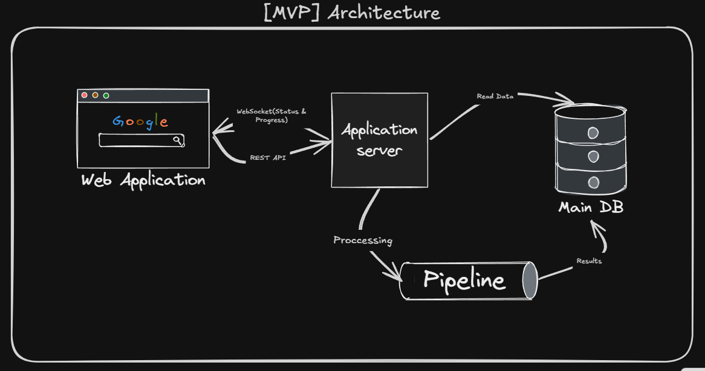
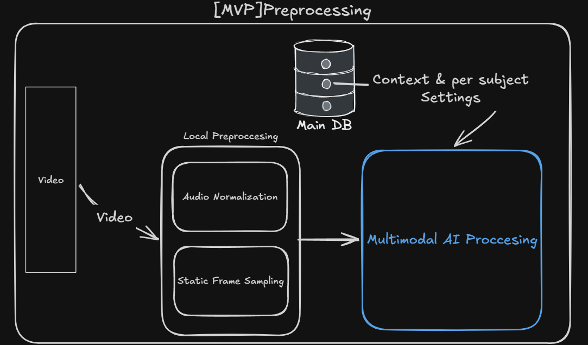
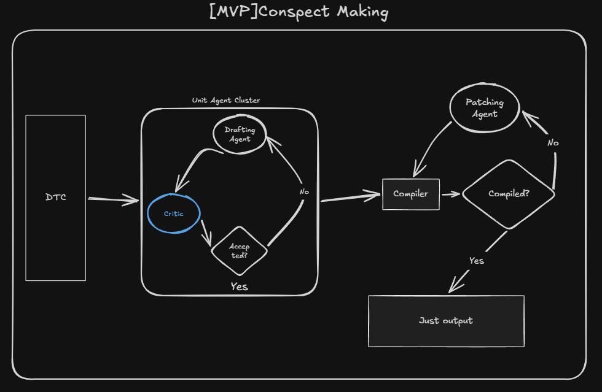

# Nestor

> A multi-agent system that turns STEM lecture videos into structured, verified LaTeX and PDF notes without hallucinations.

Nestor helps students turn university-level STEM lectures into clean, readable study materials. The system takes video files or cloud drive links, verifies formulas and proofs using specialized AI agents, and merges separate lectures into a complete course textbook.

## Key Features

* **Focused on STEM without Hallucinations:** The system is designed to minimize inaccuracies and hallucinations.
* **Human-in-the-Loop:** A simple web interface lets students review unclear parts, accept agent suggestions, and edit LaTeX source code directly.
* **Modular Pipeline:** Built with LangGraph, making it easy to swap models or adjust settings based on budget and task complexity.

---

## Architecture & System Design

### 1. High-Level Architecture (System Overview)



* **Web Application:** UI for file upload, progress monitoring, and manual note inspection.
* **Application Server:** Orchestrates background tasks and exposes endpoints.
* **Pipeline:** Coordinates execution stages from raw video to final compilation.
* **Main Database:** Stores user sessions, lecture context, and per-subject settings and etc.

---

### 2. Video Preprocessing Pipeline



* **Local Preprocessing:**
  * **Audio Normalization:** Cleans voice tracks and balances audio levels.
  * **Static Frame Sampling:** Detects board updates and removes redundant empty frames.
* **Context & Settings Injection:** Pulls course metadata and subject settings from the Database.
* **Multimodal AI Processing:** Converts synchronized video frames and audio segments into structured JSON chunks:
  ```json
  {
    "timestamp": "10:20-10:30",
    "board": "Formulas written on board",
    "lector": "Lector's spoken explanation"
  }
  ```

---

### 3. Agent Conspect Generation




1. **Unit Agent Cluster (Drafting & Critique):**
   * **Drafting Agent:** Writes the initial chapter structure and converts notes to LaTeX.
   * **Critic Agent:** Verifies formulas, theorem conditions, and logical consistency.
   * **Acceptance Gate:** If errors or hallucinations are detected, the draft is returned to the Drafting Agent for revision.
2. **Compilation & Patching Loop:**
   * **Compiler:** Compiles the verified text into PDF.
   * **Patching Agent:** If compilation fails, it patches the `.tex` source and re-runs the compiler until successful.
3. **Output:** Clean LaTeX source and compiled PDF chapter.

---

### Pipeline Models & Roles

| Pipeline Node | Model Tier | Role |
| :--- | :--- | :--- |
| **Multimodal Preprocessor** | `google/gemini-pro-latest` | Video ingestion, blackboard OCR, and speech alignment |
| **Drafting Agent** | `anthropic/claude-opus-5.5` | Academic drafting and initial LaTeX typesetting |
| **Critic Agent** | `openai/gpt-astra-latest` | Mathematical fact-checking and proof verification |
| **Patching Agent** | `anthropic/claude-sonnet-5.5` | LaTeX compilation fixing and document assembly |

---

## Tech Stack

| Part | Technologies |
| :--- | :--- |
| **Backend** | Python 3.12+, FastAPI, LangGraph, Pydantic v2 |
| **Package Manager** | uv |
| **Quality & Tests** | Ruff, Pytest |
| **Frontend** | Next.js, TypeScript, Tailwind CSS |
| **Typesetting** | TeXLive / LaTeXmk |
| **Containers** | Docker, Docker Compose |
| **Analytics** | Langfuse |
---

## Quickstart

### 1. Clone & Set Up Environment

```bash
git clone https://github.com/your-username/nestor.git
cd nestor
cp .env.example .env
```

### 2. Run with Docker Compose

```bash
docker compose up --build
```

Access the services:
* **Web UI:** `http://localhost:3000`
* **Backend API:** `http://localhost:8000`
* **API Docs:** `http://localhost:8000/docs`

---

## Demo

> *In development. A before/after example showing raw lecture video converted into compiled LaTeX notes will be added here.*

---

## License

This project is licensed under the [MIT License](LICENSE).